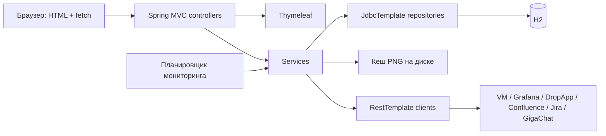

# Архитектура PerfHub: AS-IS

Срез и категории — [описание продукта](project-overview.md). Здесь описана категория **A по анализу исходников**, если не указано иное. Изменений архитектуры не выполнено. Это технический контекст согласованного baseline, а не самостоятельное разрешение на рефакторинг.

## Стек и структура

`pom.xml`: Java `release=17`, Spring Boot 3.3.4, Spring Web/MVC, Thymeleaf, Validation, JDBC, H2 2.1.214, Maven; JPA и Spring Security не используются. Frontend: Bootstrap 5.3.3, Bootstrap Icons 1.11.3 через jsDelivr, Vanilla JavaScript. Maven Enforcer исключает `httpclient5`. Тестовый стек — Spring Boot Test, JUnit, Mockito и тестовые средства Spring.

Изменение Java, фреймворков, сборщиков, хранения или версий требует отдельного OpenSpec-предложения и явного согласования владельца. Обновление библиотек не является частью baseline.

Базовый пакет `perfhub`:

| Пакеты | Ответственность и основные компоненты |
|---|---|
| `controller`, `controller/settings`, `controller/admin` | HTML через `DashboardController`, вход через `AuthController`; JSON-контроллеры предметных операций, настроек и администрирования |
| `controller/advice` | Модель навигации и отдельные обработчики ошибок по группам контроллеров |
| `service` | Поиск тестов, оценка требований, снимки, графики, публикация, настройки; `LoadTestMonitoringScheduler` — фоновые операции |
| `client` | Шесть внешних HTTP-клиентов; маршруты и авторизация — в [интеграциях](integrations.md) |
| `repository`, `repository/model` | SQL через `JdbcTemplate`, отображение строк, хранение конфигураций и предметных данных |
| `dto`, `model` | Java records для контрактов/значений, enum типов, ролей и статусов; DTO не равны схеме БД |
| `security`, `config` | `AuthenticationInterceptor`, `CurrentUserProvider`, парольный кодек; MVC, RestTemplate, bootstrap, дополнительные источники свойств |
| `registry`, `util`, `exception` | Провайдеры промптов/запросов, преобразования релизов и конфигураций, предметные исключения |

## Серверный HTML и браузер

`DashboardController` выбирает шаблон и маркеры активного раздела. `NavigationModelAdvice` добавляет текущего пользователя и роль. Единственный общий Thymeleaf-фрагмент — `templates/fragments/sidebar.html`; head, shell, footer scripts и резервная разметка меню во многих документах повторяются. `th:replace` заменяет резервное меню при серверном рендеринге.

Из 18 HTML-файлов: 17 документов и sidebar; 15 документов доступны через защищённые HTML-маршруты, login отдельно; для `index.html` явного маршрута не найдено. Большая часть логики выполняется в inline-скриптах шаблонов: `fetch`, создание DOM, фильтры, Bootstrap modals и fallback-модальные окна, уведомления, экспорт JSON. Отдельные JS: `sidebar-collapse.js`, `background-errors.js`, `lucky-reports.js` (последний подключён в index). Крупнейший `tests.html` совмещает таблицу, детали, оценку требований и публикацию.

`app.css` содержит общие и страничные стили с повторяющимися переопределениями. CSS-переменных дизайн-системы не обнаружено. Состояние свёрнутого sidebar хранится в localStorage; ранний inline-скрипт предотвращает поздний скачок состояния. Карта UI и действий приведена [отдельно](ui-map.md).

## Доступ и сессии

`AuthenticationInterceptor` защищает все MVC-маршруты, кроме login/logout/error и статических ресурсов. Числовой `currentUserId` в `HttpSession` сверяется с активной записью БД на запросе. Недействительная сессия инвалидируется. HTML-гость получает redirect на login с адресом возврата; API-гость — 401 с JSON `message`. `/admin`, `/admin/**`, `/api/admin/**` требуют `ADMIN` (иначе 403). Остальные настройки доступны также `USER`.

`AuthController` принимает форму входа и ограничивает redirect локальным путём; `ApplicationUserService` проверяет пароль. Кодек использует PBKDF2WithHmacSHA256, соль 16 байт, 210000 итераций, ключ 256 бит. Профиль не принимает роль; смена роли возможна через административный DTO. Пользователи удаляются логически. Bootstrap создаёт первоначального администратора; значения учётных данных здесь намеренно не приводятся.

**C:** отсутствие явной ротации сессии после входа, прикладной CSRF-защиты и гарантии сохранения последнего администратора требует отдельной проверки и решения; это не утверждение об успешной эксплуатации уязвимости. См. G-09.

## Фоновые операции и кеши

`LoadTestMonitoringScheduler` по умолчанию стартует через 10 секунд и опрашивает каждые 60 секунд окно 15 минут; активными считает интервалы с допуском окончания 3 минуты. При отсутствии обязательных **глобальных** настроек VM пропускает опрос. Сохраняет найденные интервалы, пытается снять недостающую конфигурацию, публикует только отличающиеся ошибки. Часть операций захвата ловит ошибки отдельных тестов и продолжает обработку.

| Хранилище / кеш | Содержание и срок жизни по реализации |
|---|---|
| `VmDataCache`, `VictoriaMetricsTestsCache`, `GigachatTestsCache`, `GrafanaRenderCache` | Последний результат в памяти singleton-компонента; не полноценная история и не пользовательская сессия |
| Токен `GigachatService` | В памяти, срок из ответа или запасной 30 минут, обновление с запасом 30 секунд; пользовательского ключа нет |
| Каталог Grafana | Таблицы панелей/переменных, доступен без нового запроса Grafana; discover обновляет локальные значения |
| `GrafanaRenderedPanelCacheService` | PNG на диске + метаданные H2. Ключ: тест, шаблон, dashboard/panel, период, hash переменных, размер, timezone. Отсутствующий/не-PNG файл удаляет запись кеша. В ключе нет пользователя и адреса Grafana |
| Оценки требований | H2; проверяется соответствие текущим панелям, query/threshold, в том числе списку кандидатов запроса для старых no-data результатов |
| `BackgroundErrorService` | Ограниченная очередь до 100 сообщений, области global/load-tests; чтение drain потребляет сообщения, пользовательского разделения нет |

**C:** персональные подключения и общие кеши образуют риск смешивания контекстов (G-07), но двухпользовательский сценарий не воспроизводился.

## Ошибки, логирование и настройки

Обработчики `ControllerAdvice` привязаны к отдельным контроллерам. Обычно предметная/входная ошибка возвращается 400, ошибка внешнего клиента — 502, однако покрытия advice различаются; единый контракт для всех исключений отсутствует. Пропуск кеша при публикации обрабатывается как 409 в Confluence advice. Другие исключения могут перейти в стандартную обработку Spring. Подробная матрица — [API](api-and-routes.md).

SLF4J используется для операций и ошибок. **C:** `ConfluenceClient.logConfluenceRequest` передаёт карту заголовков авторизации в INFO; это подтверждено кодом, реальная утечка в эксплуатационных логах не проверялась. Единый RestTemplate читает TLS-настройки из группы GigaChat при создании bean; разрешение отключить проверку SSL влияет на всех его клиентов, а не только GigaChat. Явных connect/read timeout в конфигурации этого bean не обнаружено.

Настройки запуска загружаются из ресурсов и optional `./config/application.properties`; дополнительные `.config` поддержаны зарегистрированным `ApplicationConfigPropertySourceLoader` (внешнее использование неизвестно). Настройки интеграций и бизнес-сценариев читаются через `ConfigurationProvider` из H2. Для шести подключений используется текущий пользователь; при отсутствии контекста — глобальные значения. Недостающие персональные строки копируются из глобальных. Стенд и справочники общие. Детали — [данные](data-model.md).

## Подтверждённые технические проблемы

**C:** дублирование разметки и CSS, большие inline-скрипты, несколько обязанностей у `ConfluenceService`, `GrafanaService`, snapshot service и клиентов парсинга; HTTP-вызовы внутри отдельных транзакционных сценариев; неполное MVC/браузерное покрытие. Размеры, конкретные примеры и риск переноса уже описаны в [аудите](audit/codebase-audit.md), приоритеты перед рефакторингом — в [реестре](requirements/gaps-and-decisions.md). Целевое разделение компонентов из прежнего аудита — **B**, ещё не применённая архитектура.
