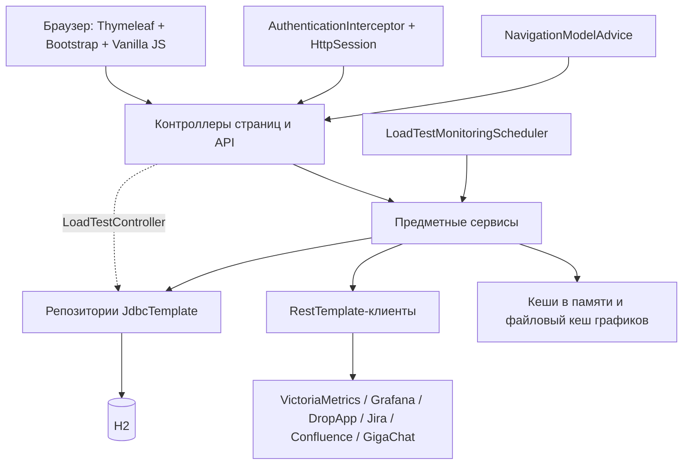

# Технический аудит PerfHub и план рефакторинга

Дата: 12 октября 2026 года. Исходная ревизия: `f3498db`, ветка `main`.

## 1. Результат и границы исследования

PerfHub — работающий серверный монолит Spring MVC с понятными слоями Java, JDBC/H2 и серверными страницами Thymeleaf. Основной долг сосредоточен в общей разметке, глобальном CSS, крупных inline-скриптах и нескольких сервисах интеграций. Переписывание приложения и смена стека не нужны. Приоритет — зафиксировать контракты, выделять общие части небольшими изменениями и проверять сохранение поведения на каждой границе.

До начала работы `git status --porcelain=v1 -uall` показывал только существующие неотслеживаемые `.agents/skills/*`, `openspec/config.yaml` и `.gitkeep` в `openspec/specs/` и `openspec/changes/archive/`. Отслеживаемые файлы не были изменены; корневого и вышестоящих `AGENTS.md` не обнаружено. Локальный OpenSpec существовал, схема — `spec-driven`, активных изменений и основных спецификаций не было. `openspec context --json` разрешил корень `/Users/mdsedov/Projects/PerfHub`.

В этом проходе разрешены и подготовлены только аудит, правила проекта, конфигурация OpenSpec и план `refactor-shared-ui-layout`. Рабочие Java, HTML, CSS, JS, SQL, зависимости и настройки приложения не изменялись. Существующие файлы навыков и `.gitkeep` сохранены; в `openspec/config.yaml` добавлены контекст и правила с сохранением исходного содержимого. Пользовательская БД не открывалась.

Исследование охватило инвентаризацию всех файлов `src/`, структуру и связи Java-пакетов, объявления маршрутов, DTO и модели, SQL репозиториев и инициализации, все шаблоны и скриптовые блоки, CSS-селекторы, тесты, Maven, ресурсы и конфигурацию. Подробно разобраны крупные узлы и повторяющиеся части. Это статический аудит с прогоном имеющихся тестов и отдельной проверкой свежей H2, а не доказательство отсутствия дефектов. Визуальные снимки, браузерное покрытие, производительность, работа реальных интеграций и состояние установленной пользовательской БД не проверялись. Подозрения на неиспользуемость ниже явно отделены от подтверждённых фактов.

## 2. Размер и состав

Метрика строк — `splitlines()` по исходным файлам, включая комментарии и пустые строки; это ориентир для декомпозиции, не метрика сложности или покрытия.

| Область | Файлов | Строк | Наблюдение |
|---|---:|---:|---|
| Основной Java-код | 243 | 18 544 | 107 DTO-records, 22 модели, 27 сервисов, 6 клиентов |
| Java-тесты | 25 | 5 997 | 130 выполненных тестов |
| Thymeleaf | 18 | 16 077 | 17 документов и один sidebar-fragment |
| CSS | 1 | 4 244 | Общие и страничные правила в одном глобальном каскаде |
| Внешние JS-файлы | 3 | 1 276 | `lucky-reports.js` 1109, `sidebar-collapse.js` 106, `background-errors.js` 61 |
| Инициализация БД | 1 | 766 | DDL, исторические преобразования и начальные данные в `schema.sql` |

Пакеты `perfhub`: `controller` (14), `controller/admin` (2), `controller/settings` (4), `controller/advice` (9, включая модель навигации), `service` (27), `client` (6), `repository` (16) и `repository/model` (3), `security` (4), `config` (4), `registry` (3), `util` (3), `exception` (18), `model` (22), `dto/**` (107), точка входа (1). Все DTO — records; в моделях 16 records и 6 enums. В DTO уже есть предметные подпакеты, тогда как `service` и `client` почти плоские.

### Зависимости и запуск

`pom.xml`: Java 17 (`maven-compiler-plugin` с `release=17`), Spring Boot 3.3.4; starters: базовый, web, thymeleaf, validation, jdbc, test. H2 2.1.214 — явная runtime-зависимость. Enforcer 3.4.1 запрещает `httpclient5`, в web-starter также задано исключение. Внешние вызовы используют `RestTemplate`; специальная конфигурация может создавать `JdkClientHttpRequestFactory`. Lombok, ORM/JPA, frontend package manager и сборщик не обнаружены.

Шаблоны подключают Bootstrap 5.3.3 и Bootstrap Icons 1.11.3 с jsDelivr. JS Bootstrap использует bundle. У Bootstrap CSS/JS прописан SRI; у icons отдельный CDN URL. Основные версии библиотек при рефакторинге сохраняются. Разные query-параметры `/css/app.css` (`perfhub-11`, `perfhub-12`, `perfhub-13`) — метки кеширования одного ресурса, а не три версии CSS в репозитории.

`src/main/resources/application.properties`: порт 6500, каталог кеша графиков, optional import `./config/application.properties`. Внешний файл задаёт относительную файловую H2 и `spring.sql.init.mode=always`. Значения учётных данных не включены в аудит. Зарегистрированный через `META-INF/spring/...PropertySourceLoader` загрузчик поддерживает расширение `.config`; отсутствие использования внутри репозитория не доказывает отсутствие внешних пользователей. `.gigaide/gigaide.properties` содержит настройки IDE, не конфигурацию Spring. `.gitignore` исключает `target/`, H2-файлы, логи и кеш изображений; CI-конфигурации, wrapper и отдельных правил форматирования в исследованном дереве не обнаружено.

Ресурсы включают логотипы/иконки, исходные изображения в `logo/`, фотографии в `photos/` и четыре трёхстрочных текстовых шаблона в `resources/config/template/` и `resources/config/tenplate/`. Они не менялись.

## 3. Текущая архитектура

Основной сценарий: поиск интервалов тестов в VictoriaMetrics → сохранение тестов → получение конфигурации через DropApp/Kubernetes и сведений Jira → проверка требований по запросам панелей Grafana → получение изображений → публикация отчётов и релизных страниц в Confluence. GigaChat использует сохранённые в памяти метрики и промпты из БД. Часть шагов запускается вручную из UI, часть — планировщиком.

- Авторизация собственная: `AuthController`, `AuthenticationInterceptor`, `ApplicationUserService`, `PasswordHashService`, `HttpSession`. Есть пользовательские роли; `/admin`, `/admin/**`, `/api/admin/**` ограничены администратором. Для гостя HTML перенаправляется на login, API возвращает 401; для недостаточных прав — 403. Spring Security в зависимостях нет; замена механизма не входит в рефакторинг.
- `NavigationModelAdvice` предоставляет пользователя, имя и признак администратора; `DashboardController` задаёт `activePage`, `activeSettingsSection`, `activeAdminSection`. Fragment `sidebar.html` использует эти атрибуты.
- `ConfigurationService`/`ConfigurationRepository` отделяют пользовательские подключения от глобальных настроек. `CurrentUserProvider` читает request/session; фоновые задачи без request используют глобальную конфигурацию. `BootstrapAdminInitializer` и доступ через конфигурационный сервис могут копировать глобальные подключения пользователю.
- Репозитории используют SQL и `JdbcTemplate`; схемы ORM нет. Основные группы таблиц: пользователи и настройки; типы и интервалы тестов; Kubernetes-конфигурации и DropApp-снапшоты/документы/дистрибутивы; шаблоны и ссылки Confluence; Grafana-панели/переменные/кеш изображений; промпты и результаты проверки требований. Исторический `confluence_templates` продолжает читаться для `createReportHierarchy`, поэтому его нельзя удалять как заведомо устаревший.
- `LoadTestMonitoringScheduler.java:46` по умолчанию стартует через 10 секунд и опрашивает VM каждые 60 секунд; пропускает работу при незаполненной глобальной конфигурации. `BackgroundErrorService` хранит общую очередь с областями, API извлекает сообщения с удалением из очереди.
- Есть singleton-кеши последних VM/GigaChat/Grafana-ответов. `GrafanaRenderedPanelCacheService` хранит изображения в файловой системе и метаданные в H2. Эти механизмы имеют разные контракты и не должны объединяться только по похожим именам методов.

### Интеграции и границы

| Интеграция | Компоненты | Что сохранять |
|---|---|---|
| VictoriaMetrics | `VictoriaMetricsClient`, `VictoriaMetricsService`, планировщик | PromQL/Graphite-преобразования, временные диапазоны, объединение интервалов, кеши |
| Grafana | `GrafanaClient`, `GrafanaService`, сервисы настроек/переменных/кеша | Панели внутри rows, переменные, PNG-проверка, fallback slug, ключи кеша |
| DropApp/Kubernetes | `DropAppClient`, `DropAppService`, `DropAppConfigurationSnapshotService`, `KubernetesConfigurationService` | Состав ресурсов, группировку, выбранные namespaces/services, YAML и ZIP, версии и релизы |
| Jira | `JiraClient` и сервис снапшотов | Поиск релиза, fallback API, разбор HTML/wiki таблиц дистрибутивов |
| Confluence | `ConfluenceClient`, `ConfluenceService`, шаблоны, throttler | Storage-разметку, placeholder-ы, вложения, порядок операций, retry, версии страниц, ссылки |
| GigaChat | `GigachatClient`, `GigachatService`, registry/providers | Получение и срок жизни токена, тексты промптов, структуру запросов и использование кеша VM |

## 4. Маршруты и страницы

Источник HTML-маршрутов: `DashboardController.java:20`, `AuthController.java:24`. `/` перенаправляет на `/main`; `/admin` рендерит тот же `admin-users`, что и `/admin/users`, без обязательного редиректа.

| URL | Шаблон | Строк HTML / inline JS | Назначение |
|---|---|---:|---|
| `/main` | `main.html` | 142 / 10 | Главные переходы |
| `/tests` | `tests.html` | 4716 / 4239 | Тесты, фильтры, модальные детали, требования, графики, отчёты |
| `/reports` | `reports.html` | 594 / 417 | Существующий экран отчётов; маршрут сохраняется |
| `/configuration` | `configuration.html` | 1740 / 1477 | Конфигурации и снапшоты |
| `/grafana-panels` | `grafana-panels.html` | 1323 / 1041 | Выгрузка графиков |
| `/settings` | `settings.html` | 982 / 831 | Общие настройки и операции импорта/экспорта |
| `/settings/connections` | `settings-connections.html` | 1061 / 818 | Подключения и их проверка |
| `/settings/templates` | `settings-templates.html` | 1738 / 1356 | Шаблоны и панели отчётов |
| `/settings/stand-configuration` | `settings-stand-configuration.html` | 528 / 351 | Выбор состава конфигурации стенда |
| `/settings/grafana-dashboards` | `settings-grafana-dashboards.html` | 830 / 603 | Дашборды, панели, переменные, требования |
| `/settings/requirements` | `settings-requirements.html` | 404 / 288 | Старый экран НФТ; действующий маршрут |
| `/settings/victoria-metrics` | `settings-victoria-metrics.html` | 329 / 214 | Старый экран VM; действующий маршрут |
| `/admin`, `/admin/users` | `admin-users.html` | 547 / 412 | Пользователи и роли |
| `/admin/test-types` | `admin-test-types.html` | 498 / 370 | Типы тестов |
| `/profile` | `profile.html` | 277 / 176 | Профиль и выход |
| `/login`, GET/POST | `login.html` | 77 / 13 | Отдельная публичная страница входа |
| Нет явного mapping | `index.html` | 177 / 10 | Кандидат на устаревший вход; содержит `lucky-reports.js` |

Inline JS посчитан по содержимому `<script>` без `src`, включая начальную подготовку sidebar. `fragments/sidebar.html` — ещё 114 строк. В активной оболочке 15 разных шаблонов; login — шестнадцатый документ, `index.html` требует отдельного решения о достижимости. Наличие маршрута `/reports` или старых settings-страниц важнее отсутствия ссылки на них в текущем меню.

### API

Ниже base path и относительные пути; завершающие `/` указаны как в аннотациях и должны сохраняться. Вход, выход и права также часть контракта.

| Контроллер / base path | Методы и пути |
|---|---|
| Auth | GET/POST `/login`, POST `/logout` |
| LoadTest `/api/tests` | GET base, `/{testUuid}/configuration`, `/{testUuid}/configuration/archive`; POST `/{testUuid}/configuration/capture`, `/{testUuid}/comment`, `/{testUuid}/report-details`, `/{testUuid}/type` |
| TestType `/api/test-types` | GET base |
| VictoriaMetrics `/api/victoriametrics` | POST `/data/`, `/tests/` |
| Grafana `/api/grafana` | POST `/panels/`, `/panels/range`, `/panels/range/panel` |
| Requirement `/api/requirements` | POST `/evaluate`, `/status` |
| Confluence `/api/confluence` | POST `/report/`, `/report/hierarchy/`, `/report/release-page/`, `/report/release-page/links/`, `/charts/append/`; GET `/report/parent-pages/` |
| DropApp `/api/dropapp` | GET `/configuration`, `/namespaces`, `/services`, `/configuration/saved`, `/configuration/saved/{snapshotId}`, `/configuration/saved/{snapshotId}/archive`; POST `/configuration/capture`, `/configuration/saved`; PATCH/DELETE `/configuration/saved/{snapshotId}` |
| GigaChat `/api/gigachat` | GET `/token`; POST `/request/`, `/tests/`, `/test/compliance/` |
| Configuration `/api/perfhub/properties/` | GET, PATCH base |
| ConnectionTest `/api/perfhub/connections` | POST `/{service}/test` |
| BackgroundError `/api/background/errors` | GET base с необязательным scope |
| StandConfiguration `/api/settings/stand-configuration` | GET, PATCH base |
| GrafanaDashboard `/api/settings/grafana-dashboards` | GET/POST base, GET `/discover`, PUT/DELETE `/{uid}` |
| ConfluenceTemplate `/api/settings/confluence-templates` | GET/POST base; GET `/export`, `/panel-options`; PUT/DELETE `/{id}` |
| NonFunctionalRequirement `/api/settings/non-functional-requirements` | GET/POST base, PUT/DELETE `/{id}` |
| UserAdmin `/api/admin/users` | GET/POST base, GET `/roles`, PUT/DELETE `/{id}` |
| TestTypeAdmin `/api/admin/test-types` | GET/POST base, PUT/DELETE `/{id}` |
| Profile `/api/profile` | GET, PUT base |

## 5. Приоритетные проблемы

Приоритеты: P1 — раннее рассмотрение из-за влияния или риска регрессии; P2 — следующий этап сопровождаемости; P3 — локальная уборка после подтверждения. Порядок ниже учитывает важность аудита, а не разрешение исправлять всё в первом изменении. Для каждого пункта приведены подтверждение, влияние, риск исправления и решение.

| № / приоритет | Файлы и конкретное подтверждение | Влияние | Риск исправления | Рекомендуемое решение |
|---|---|---|---|---|
| 1 / P1 | `client/ConfluenceClient.java:64`, `:367`, `:573`: `authorizationHeaders` передаёт заголовки в `logConfluenceRequest`, который пишет `headers.toSingleValueMap()` на INFO | При выполнении запросов в лог попадает заголовок авторизации. Подтверждён путь кода, реальные секреты и логи не извлекались | Низкий для маскирования; изменение наблюдаемого логирования требует отдельного плана | Отдельный `harden-integration-logging`: разрешённый набор полей/маскирование, тест фиктивного заголовка, без изменения HTTP-запроса. Не включать в UI-рефакторинг |
| 2 / P1 | `src/test/java/**`, `PerfHubApplicationTests.java:6`: есть unit/JDBC/context tests, нет MockMvc, web-slice, рендер-тестов Thymeleaf и браузерных тестов | Зелёный Maven не защищает DOM-контракты, права, навигацию и JS при переносе оболочки | Низкий/средний: неправильные фикстуры могут скрыть настоящую авторизацию | В каждом UI change сначала фиксировать контракт рендеринга и роли; для первого — матрица всех страниц, DOM и ресурсов плюс браузерный smoke |
| 3 / P1 | `static/css/app.css:2`, `:1243`, `:1459` и ещё пять `body`; sidebar 300 px повторяется, в `:3943` задано 340 px; `.toast-container` в `:2536` допускает 640 px, в `:2983` и `:3488` снова 360 px | Повторные общие селекторы и каскадные перекрытия связывают стили разных страниц; CSS-переменных нет | Высокий при массовом удалении: media queries и порядок влияют на все страницы | Отдельно токены по фактическим значениям, затем общие компоненты и область действия страницы. Не считать sidebar media queries ошибкой; сохранить итоговый каскад |
| 4 / P1 | `templates/tests.html:3`, `:30`, `main.html:30`, `settings-templates.html:30` и другие: повторён head и полная старая разметка внутри `th:replace`; единственный fragment — `fragments/sidebar.html:4` | Изменение общих ресурсов и структуры требует правок множества файлов; исходные копии расходятся с реальным sidebar с пользователем и администрированием | Средний: порядок JS, DOM ID, роль, фон страницы и восстановление sidebar | Первое `refactor-shared-ui-layout`: общие head/shell/scripts и существующий sidebar, удаление заменяемого fallback только при переносе; без переписывания логики |
| 5 / P1 | `templates/tests.html:484` — большой inline-блок; функции `submitGenerateReports:2063`, `loadTestDetails:3747`, `renderTests:4276`, `autoRefresh:4633`; 4239 строк inline JS всего | Состояние таблицы, HTTP, модальные окна, кеши, отчёты и polling сцеплены в одном документе | Высокий: двойные обработчики/таймеры, потеря выбранных тестов, иной порядок внешних операций | Несколько изменений: сначала механическое извлечение скрипта, затем состояние/таблица, затем детали и публикация. Проверить 30-дневный поиск, фильтры, массовые операции и fallback Bootstrap |
| 6 / P1 | `service/ConfluenceService.java` — 1935 строк и 9 зависимостей; `createSingleReport:393`, `buildReportBody:786`, маркеры `:1044`, `waitForPageAvailability:1634`, upload/update retry `:1689`, `:1755` | Смешаны сценарий публикации, шаблонизация, HTML/XML/JQL, вложения и повторные запросы | Высокий: внешние побочные эффекты и частично созданные отчёты, чувствительность storage-разметки | Сначала чистый renderer с эталонными строками, затем отдельно publisher/retry с тестами порядка вызовов и ошибок; оставить публичный фасад |
| 7 / P1 | `repository/NonFunctionalRequirementRepository.java:32` читает `non_functional_requirements`; в `schema.sql` таблицы нет; контроллер и маршрут существуют | Свежая БД не поддерживает старый API НФТ. Независимый SQL в тестовой H2 вернул 42102; реальные установки не проверялись | Высокий для «попутной» починки: создание таблицы или удаление маршрута меняет контракт/БД | Отдельное исследование и решение о поддержке legacy НФТ; не менять схему, маршрут или поведение в текущей цепочке рефакторинга |
| 8 / P1 | `PerfHubApplicationTests.java:6` не задаёт изолированную БД; `application.properties:8` импортирует внешний файл; внешний config включает файловую H2 и SQL init; `BootstrapAdminInitializer.java:23` пишет данные | Обычный тест из рабочего каталога может открыть и изменить локальную пользовательскую БД | Средний: необходимо сохранить проверку реальной схемы и контекста | Независимый `isolate-test-runtime`: тестовая H2/каталог кеша, исключение внешних подключений и побочных фоновых вызовов; до этого запускать в временной копии |
| 9 / P2 | `showToast` повторяется в семи местах, например `tests.html:2294`, `settings-connections.html:333`, `profile.html:133`; `createModalController` — в четырёх; `extractErrorMessage` — в шести, с разными сигнатурами | Разные таймеры/ошибки/fallback-ы, повторяемые исправления; одинаковые имена не означают одинаковое поведение | Средний/высокий при замене одним helper без сравнения семантики | Отдельные общие уведомления/модальные адаптеры, затем HTTP-helper с сохранением обработки JSON, текста и пустого ответа; миграция по одной странице |
| 10 / P2 | `LoadTestController.java:54`, `:96`, `:127` напрямую читает и обновляет репозитории и проверяет тип; `controller/advice/*` повторяет `{message}` records, но `UserControllerExceptionHandler.java:19` возвращает Map; часть ошибок — `ResponseStatusException` | Сценарии и HTTP-представление смешаны, ошибки сложнее поддерживать единообразно | Средний: объединение advice может изменить приоритет, статус и JSON | Отдельные `refactor-load-test-application-service` и `refactor-http-error-mapping`: сначала контрактные тесты; общий внутренний тип без нормализации публичных ответов |

В таблице Java-пути с `client/`, `service/`, `repository/`, `controller/` относятся к `src/main/java/perfhub/`; `templates/` и `static/` — к `src/main/resources/`.

### Дополнительные наблюдения

| ID / приоритет | Подтверждение и влияние | Риск / действие |
|---|---|---|
| A11 / P2 | `DropAppClient.java` 955 строк: HTTP, сопоставление deployment/pod, версии, сериализация YAML; `JiraClient.java` 794: HTTP и HTML/wiki parsing; `DropAppConfigurationSnapshotService.java` 827: получение, обогащение Jira, сохранение, архив | Высокий при одновременном разделении. Выделять по одному чистому parser/formatter/архиватору с фикстурами; транспорт и порядок операций сохранять |
| A12 / P2 | `VmDataCache`, `VictoriaMetricsTestsCache`, `GigachatTestsCache`, `GrafanaRenderCache` хранят последнее значение singleton; `GigachatService.java:94` использует один кеш токена, а настройки подключений пользовательские | Подтверждена разная область состояния, но межпользовательская ошибка не воспроизводилась. Отдельные тесты двух пользователей и фона; изменение области кеша — отдельное функциональное решение, не механическая унификация |
| A13 / P2 | `schema.sql:1–766` объединяет создание таблиц, повторяемые ALTER/UPDATE и seed. `:758` удаляет старую колонку результатов НФТ при SQL init | Риск на существующих данных; установленные БД не исследованы. Сначала тесты свежей и обезличенной исторической схемы. Ни миграционный инструмент, ни обновление H2 не предлагаются в первом change |
| A14 / P3 | У `index.html` нет явного controller mapping, `/` отправляет на `/main`; `lucky-reports.js` подключён только в `index.html`. Для четырёх `.txt`, включая опечатку `config/tenplate/soak.txt`, ссылок загрузки не найдено; `TemplateLoader` читает БД | Кандидаты на неиспользуемость, не доказанный мусор. Проверить welcome mapping, внешние ссылки и способ поставки шаблонов, затем отдельное удаление. `/reports`, legacy API и `.config` loader не удалять по этому наблюдению |
| A15 / P3 | `src/test/java/perfhub/client/VictoriaMetricsClientTest.java:20` и `perfhub/vm/VictoriaMetricsClientTest.java:21` повторяют основной query-range сценарий; первый также проверяет спецсимволы | Низкий. Объединить фикстуры отдельно, сохранить все утверждения и сценарий encoding; число тестов само по себе не критерий качества |
| A16 / P2 | `ApplicationUserService.java:19` содержит фиксированное начальное учётное значение; `RestTemplateConfig.java:37` допускает отключение проверки TLS для общего клиента | Подтверждена возможность в коде; использование небезопасной настройки и состояние реальных учётных записей неизвестны. Отдельный обзор безопасности; значения не воспроизводить. Изменение bootstrap/авторизации/TLS вне текущего рефакторинга |

### Подробные границы крупных узлов

`tests.html`: первая граница — неизменяемый перенос текущего page-script в один файл. Затем отдельно выделяются состояние/фильтры/таблица, получение данных и оценка требований, модальные детали с графиками и конфигурациями, создание Confluence-отчётов. Московское время, ключи browser storage, активные тесты, ожидание фоновых запросов и очереди захвата конфигурации — контракты, а не удобные места для «улучшений». Код генерации отчётов в `lucky-reports.js` похож на логику tests, но объединение допустимо только после решения о достижимости index и сравнения сценариев.

`app.css`: файл фактически собран из восьми страничных блоков с глобальными селекторами и поздними overrides. Простое разнесение по файлам может изменить порядок каскада. Сначала сохранить список подключений и вычисленные стили характерных элементов; потом выделить токены, затем общий sidebar/оболочку, затем компоненты и страничные правила. Наличие `@media` само по себе не дублирование, подлежащее удалению.

Thymeleaf: действующий fragment только один; содержимое узла `th:replace` не попадает в серверный результат, поэтому его копии — подтверждённая избыточность при серверном рендеринге. Однако статическое открытие шаблона и серверный HTML различаются. Первый change гарантирует серверный UI, а не автономную работу HTML-файлов с диска.

`ConfluenceService`: кандидат `ConfluenceReportRenderer` должен получать готовую модель и не обращаться к HTTP/БД; построение XML/HTML, escaping, placeholder-ов и маркеров проверяется строковыми эталонами. Отдельный publisher сохраняет порядок create → availability → attachments/archive → update и существующие 6 попыток availability / 5 попыток upload/update с задержкой 700 ms. Повторные запросы не объявляются идемпотентными. Throttler дерева страниц и legacy hierarchy остаются самостоятельными контрактами. Не объединять эту работу с UI.

## 6. Тесты, выполненные проверки и пробелы

`mvn test` выполнен на неизменённой копии `pom.xml`, `src/` и внешнего файла конфигурации в отдельном временном каталоге. Относительный путь H2 предварительно проверен; пользовательские `.mv.db`, кеш, экспорты и логи не копировались. Команда именно `mvn test`, без `skipTests`, исключений тестов и исправлений исходников. Maven 3.9.10, OpenJDK 21.0.11 (Homebrew), macOS arm64; компиляция с `release=17`.

**Результат: BUILD SUCCESS; 130 tests, 0 failures, 0 errors, 0 skipped; 25 классов; 7.569 секунды по Maven.** Это не прогон на JDK 17. Отдельные CI/JDK 17, визуальные, нагрузочные и реальные интеграционные проверки не выполнялись. Процент покрытия не вычислялся: инструмент покрытия не настроен; количество тестов не заменяет покрытие ветвей.

| Проверяемая область | Тестов | Что уже проверяется / чего не хватает |
|---|---:|---|
| ConfluenceService | 15 | Шаблоны, title/body, дубликат заголовка, hierarchy, дерево, append, релизные маркеры/Jira; нет полного покрытия retry/interruption/частичной публикации и HTTP-клиента |
| GrafanaService / GrafanaClient / настройки | 14 / 9 / 3 | PNG, переменные, slug fallback, кеш, диапазоны, rows и offline; нет прямого полного теста файлового кеша |
| RequirementEvaluationService | 11 | Шаблоны, thresholds, Graphite fallback, устаревший кеш; нет MVC-контракта |
| VictoriaMetricsService / клиенты | 6 / 3 | Диапазоны, кодирование query, интервалы, кеш; один клиентский сценарий повторён |
| DropApp снапшоты / сервис / клиент | 9 / 9 / 1 | Сохранение, выбор ресурсов, релиз/Jira, группировка; мало покрытия YAML/ZIP и вариантов Kubernetes |
| JiraClient | 8 | API, поиск релиза и HTML/wiki таблицы; граничные варианты parser ещё нужны |
| ConfluenceTemplateSettingsService | 8 | Имена типов, page ID, inline/body/import; нет web-валидации |
| TestTypeAdminService | 7 | Стандартные и пользовательские типы, ограничения изменения/удаления |
| ApplicationUserService | 3 | Создание и начальные данные; нет полного login/session/roles/logout и отрицательных сценариев |
| Configuration service/repository | 3 / 3 | Пользовательские подключения, глобальные значения, копирование, обязательные поля |
| LoadTestRepository | 3 | Объединение интервалов; прочие репозитории главным образом без прямого JDBC-покрытия |
| Scheduler / BackgroundErrorService | 3 / 2 | Незаполненная конфигурация, захват, дедупликация ошибок и scope; нет проверки нескольких браузеров |
| GigaChat | 1 | Сообщения system/user; нет HTTP-client/token expiry/двух пользователей |
| Utils / LoadTestType / Spring context | 6 / 2 / 1 | Релизы, группировка, legacy тип, запуск контекста; контекст не вызывает каждый API |

Сумма строк таблицы — 130. Для будущего UI-рефакторинга нужны: реальный рендер шаблонов через Spring/Thymeleaf; единственность DOM ID и ресурсов; матрица гостя/пользователя/администратора; сохранение заголовков и active navigation; sidebar при 992/993 px, закрытый/открытый и недоступный localStorage; модальные окна и fallback без Bootstrap JS; загрузка/ошибка/пустой результат; отсутствие двойного polling и прежние fetch URL/body. Всё возможно начать с имеющегося `spring-boot-starter-test` и ручного браузерного smoke без новой зависимости. Не добавлять тесты, которые проверяют только наличие конкретного fragment в исходнике вместо результата рендеринга.

Дополнительная диагностика свежей H2 после тестов: read-only SELECT по `INFORMATION_SCHEMA.TABLES` дал 0 для `NON_FUNCTIONAL_REQUIREMENTS`; SQL к таблице вернул `42102-214`. Оболочка H2 Shell завершилась кодом 0, поэтому сам exit code здесь не означает успешный SQL. Это отдельная найденная проблема, не падение `mvn test`.

OpenSpec-команды выдавали предупреждение о `NODE_TLS_REJECT_UNAUTHORIZED=0` в окружении процесса. Настройка не менялась; она не является конфигурацией TLS приложения и не скрывает результат проверки артефактов.

## 7. Целевая архитектура и стандарты

### Java

Сохранить монолит и существующие слои. Контроллер → сервис сценария → repository/client; небольшие предметные renderer/parser/mapper рядом со своим сценарием. Постепенные подпакеты `service/confluence`, `service/dropapp`, `client/jira` допустимы в соответствующих отдельных изменениях; массовое перемещение всех классов не нужно. DTO остаются records в уже существующих предметных подпакетах, model — внутренние данные, SQL-records — в repository/model. Не вводить интерфейс на каждый класс без второго применения.

Четыре пробела, явные импорты, constructor injection, final-зависимости, однозначные имена методов; не смешивать механическое форматирование с переносом логики. Jakarta Validation для входных DTO, предметные проверки в сервисе, сохранение нынешних HTTP-статусов и сообщений. Обработчики ошибок можно объединять только после фиксации их assignableTypes и внешних ответов. SLF4J с параметрами, безопасные идентификаторы и причина ошибки; заголовки/тела/секреты не выводить. Существующий небезопасный лог исправлять отдельным change. Транзакции, время и retry сохранять при переносе.

### Thymeleaf и JavaScript

Целевые fragments: общий head; ранняя подготовка sidebar; текущий sidebar; оболочка `.app-shell > .sidebar + .page-content`; подключения общих скриптов; по мере подтверждения — контейнер уведомлений, заголовок страницы, toolbar и повторяющаяся форма. Таблицы и модальные окна не превращать в универсальный компонент с десятками параметров. Общие fragments принимают разметку слота и небольшое число явных параметров, сохраняют DOM без лишних wrappers.

Целевая структура JS: `static/js/shared/{http,notifications,modal,date-time}.js`, `static/js/pages/<page>.js`, предметные части tests в отдельном подпакете. Это направления, не обещание создать все файлы. Сначала механический перенос, затем выделение общих функций с сравнением семантики. Нативные ES-модули без bundler допустимы позднее; переход `script → type=module` меняет время/область выполнения и требует отдельной проверки. Первый change оставляет page-script на прежнем месте и с прежним типом. Единственное общее раннее inline-исключение — восстановление класса sidebar до отображения.

### Визуальная система PerfHub

Цель — закрепить имеющийся бело-зелёный стиль, логотипы, спокойную серую навигацию и Bootstrap-поведение. Ни редизайн, ни новая палитра не нужны. Приведённые токены — проектируемые имена на основе исходного CSS, не уже реализованная система; окончательное сопоставление каждому селектору проверяется по вычисленным стилям перед CSS change.

| Группа | Предлагаемый стандарт |
|---|---|
| Цвета | `--perfhub-surface: #ffffff`, `--perfhub-background: #f5fff9`, `--perfhub-text: #5f5e5b`, `--perfhub-text-strong: #1c231f`, `--perfhub-text-muted: #6a7c73`, `--perfhub-border: #e5e7eb`, `--perfhub-border-soft: #e5efe8`, `--perfhub-accent: #009846`, `--perfhub-accent-strong: #0b6b3c`, `--perfhub-link: #2783de`; семантические success/warning/danger остаются различимыми |
| Типографика | Существующий стек `SF Pro Display, Roboto, Segoe UI, sans-serif`; шкала для основного текста, muted-подписей и заголовков без массовой замены h5/h1. Сначала сохранить текущие размеры; затем согласовать общий компонент заголовка |
| Отступы | Шкала rem на основе Bootstrap: 0.25, 0.5, 0.75, 1, 1.5, 2, 3; именованные токены только для повторяемых компонентных значений; не переопределять все Bootstrap utilities |
| Кнопки | Сохранить `.btn`, success/outline-success и текущие действия; единые размер, disabled/busy/focus, иконка+подпись. Не заменять action-button ссылкой и не менять submit/type |
| Таблицы | Общий вид заголовка, границ и ячеек; overflow-контейнер для широких данных; индивидуальная ширина колонок и селекторы строк сохраняются |
| Формы | Общие label/help/error, интервалы и focus; сохранение `name`, `required`, autocomplete, validation и значений; подписи не заменять только placeholder-ами в рамках механического переноса |
| Карточки | Белый фон, существующие мягкие границы, радиус 14 px там, где он уже используется; отдельные токены радиусов 6/10/14 px. Глобальный `.card-body {padding:0}` сначала изолировать, не удалять без проверки |
| Уведомления | Общие визуальные варианты info/success/warning/danger и закрытие; первоначально сохранить действующую геометрию, duration и DOM. Изменение ширины или ARIA-анонса — отдельное явно проверяемое решение |
| Навигация | Sidebar 340 px при ≥993 px, 88 px в свёрнутом состоянии; мобильный режим ≤992 px; логотип и favicon прежние; видимость пунктов по роли и active markers неизменна |

Первый change централизует структуру и подключения, оставляя CSS побайтно прежним. Так базовая консистентность обеспечивается единым источником оболочки и ресурсов. Внедрение CSS-переменных, унификация карточек/кнопок/форм и устранение каскадных конфликтов — следующие отдельные изменения с визуальной проверкой.

## 8. Последовательность небольших изменений OpenSpec

Создан только первый change; остальные имена ниже — предлагаемый backlog, не существующие каталоги и не разрешение на реализацию. Для каждой записи сначала отдельное предложение и строгая валидация. Независимость означает отдельный откатываемый diff; зависимости отмечают необходимый базовый контракт, а не необходимость выполнить весь список разом.

| Очерёдность / change | Область и результат | Зависимости | Приёмка / риск |
|---|---|---|---|
| 1. `refactor-shared-ui-layout` | Общие head/shell/sidebar/scripts, удаление заменяемых копий, неизменный серверный UI | Нет; тесты в временной копии | Рендер 15 страниц + login, роли и DOM/resources, browser smoke; средний |
| 2а. `isolate-test-runtime` | Отдельная тестовая H2, кеш и безопасные внешние заглушки | Независимо от UI | Тесты не меняют рабочие файлы, контекст и схема по-прежнему проверяются; средний |
| 2б. `harden-integration-logging` | Маскирование заголовков Confluence, безопасная политика логирования | Независимо; отдельное изменение логов | Фиктивные секреты отсутствуют в captured logs, HTTP не меняется; низкий. При реальном использовании интеграции ценность выше UI |
| 3. `refactor-ui-design-tokens` | Введение переменных поверх текущих значений, без переноса правил | 1 | Сравнение computed styles и скриншотов, порядок CSS прежний; средний |
| 4. `refactor-shared-ui-styles` | Поочерёдное устранение дублей sidebar, затем карточек/уведомлений, локализация page-стилей | 3 | Отдельные проверяемые группы задач; порядок каскада, 992/993 px; высокий. При большом diff разделить change по компонентам |
| 5. `refactor-tests-page-script` | Механическое извлечение текущего tests-script в отдельный файл | 1 | Те же DOM/URL/таймеры, без ES-module conversion и дробления логики; средний |
| 6а. `refactor-shared-ui-feedback` | Общий toast/modal adapter с сохранением различий параметрами | 1, желательно 5 для tests | Закрытие/таймеры/Bootstrap fallback, одна мигрируемая страница за задачу; средний |
| 6б. `refactor-page-http-helpers` | Общая обработка JSON/текста/пустого ответа | После фиксации API-контрактов, независимо от CSS | Ошибки/204/401, payload и метод без изменений; средний |
| 7а. `refactor-tests-table-state` | Состояние, фильтры, выбор и рендер таблицы tests | 5 | Сохранение выбора, сортировки, обновления активных тестов; высокий |
| 7б. `refactor-tests-report-workflow` | Детали и публикация отчётов отдельными предметными частями | 7а | Последовательность запросов, частичные ошибки, отсутствие дублей; высокий |
| 8а. `refactor-confluence-report-renderer` | Чистое формирование разметки и placeholder-ов за существующим фасадом | Регрессионные фикстуры, желательно 2а; независимо от UI | Строковые эталоны XML/HTML, Jira-макросы/escaping/даты; высокий |
| 8б. `refactor-confluence-publication` | Сценарий публикации, загрузка вложений, retry | 8а | Mock-порядок вызовов, попытки, interruption, частичные результаты; высокий |
| 9а. `refactor-jira-distribution-parser` | HTML/wiki parser вне HTTP-клиента | Независимо после parser-фикстур | Те же distributions на наборе ответов; средний |
| 9б. `refactor-dropapp-document-serializer` | YAML serializer вне DropAppClient | Независимо после YAML-фикстур | Те же документы, escaping и сортировка; средний |
| 9в. `refactor-configuration-archive` | ZIP-формирование вне сервиса снапшотов | Тесты архивов; независимо от 9а | Те же имена, состав и содержимое файлов, даты учитывать отдельно; средний |
| 10а. `refactor-load-test-application-service` | Убрать сценарий работы с репозиториями из LoadTestController | API-контрактные тесты | Те же DTO, сортировка, валидация и ошибки; средний |
| 10б. `refactor-http-error-mapping` | Внутреннее единообразие DTO/advice | Зафиксированные ответы всех затрагиваемых API | Сохранение статусов/тел, отсутствие расширения области advice; средний |
| 11. `prune-confirmed-unused-assets` | Только доказанно недостижимые index/lucky/text assets и дубли тестов | Проверка достижимости и потребителей | Нет пропавших маршрутов/ресурсов/сценариев; низкий после доказательства |

Legacy НФТ, область кешей/токенов, bootstrap/TLS и изменения схемы — отдельные вопросы продукта/безопасности, не часть «поведение не меняется». По ним сначала уточнить контракт в отдельном OpenSpec-предложении; текущие ограничения на авторизацию и БД сохраняются. Другие крупные inline-страницы (`configuration`, `settings-templates`, `grafana-panels`) переносить отдельным change на каждую после проверки подхода на tests, а не пакетом вместе с ним.

Общий способ отката: вернуть файлы одного применённого изменения к его исходному состоянию, не меняя данные; новые shared-файлы удалять только после возврата всех потребителей. Для чистого рефакторинга миграции БД и внешние операции отката не требуются. При обнаружении изменения поведения остановить соответствующую задачу, зафиксировать расхождение и исправить план/реализацию, не ослаблять проверку.

## 9. Подготовленные артефакты и итоговые проверки

- `AGENTS.md` — обязательный OpenSpec-процесс, границы, соглашения и проверки.
- `openspec/config.yaml` — русский контекст и правила proposal/specs/design/tasks.
- `openspec/changes/refactor-shared-ui-layout/.openspec.yaml` — метаданные CLI.
- `proposal.md` — причины, узкая область, исключения, capability `shared-ui-layout`.
- `design.md` — fragments, матрица подключения ресурсов, миграция и откат.
- `specs/shared-ui-layout/spec.md` — впервые формализованные контракты существующей оболочки и совместимости; новые пользовательские функции не добавляются.
- `tasks.md` — незавершённые задачи будущей реализации с проверками.

Машинные заголовки OpenSpec сохранены в формате схемы, содержимое написано по-русски. Основные `openspec/specs/` в этом проходе не синхронизируются: delta остаётся предложением до применения.

Результаты проверок подготовки:

- `openspec validate refactor-shared-ui-layout --strict` — exit 0, `Change 'refactor-shared-ui-layout' is valid`.
- `openspec status --change refactor-shared-ui-layout` — готовы 4/4 артефактов планирования. В спецификации 9 требований и 22 сценария; в tasks 23 задачи, выполненных 0. Статус готовности артефактов не означает реализацию.
- SHA-256 для 319 исходно зафиксированных файлов: удалений нет; единственное изменение существующего файла — дополнение `openspec/config.yaml`; его исходное содержимое сохранено. Исходники, тесты, настройки приложения и файлы навыков не изменены.
- `git diff --check` успешен; поскольку новые документы неотслеживаемые, дополнительно проверены их концевые пробелы и локальные Markdown-ссылки — ошибок нет. Поиск характерных секретных литералов в подготовленных файлах совпадений не дал.
- В рабочем дереве добавлены только документы и OpenSpec-план; исходные неотслеживаемые `.agents/` и OpenSpec-файлы не удалены. Commit, push, deployment, применение и архивирование не выполнялись.
